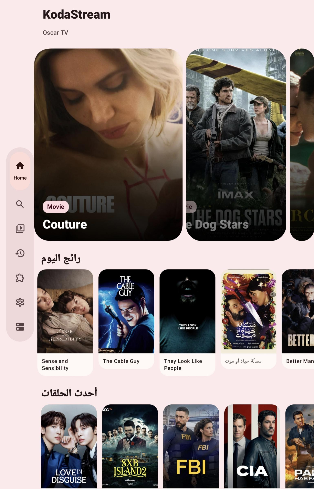
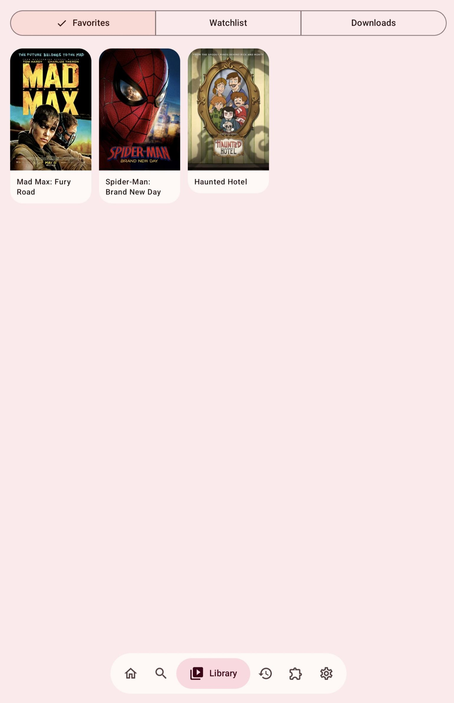
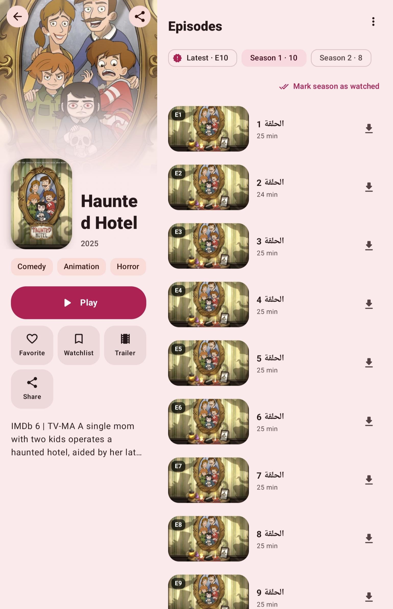
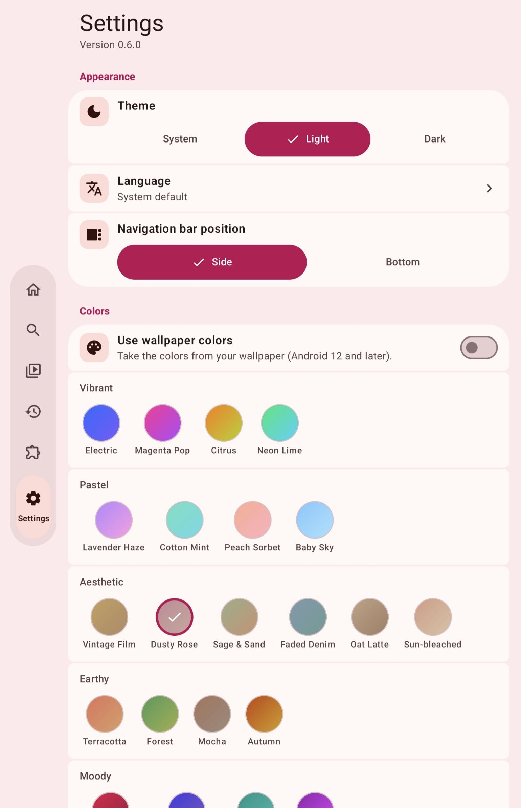

  

  

<h1 align="center">cloud3</h1>

cloud3 is an Android app for watching movies and series. 
Add extensions to connect your favorite sources, then browse, search, and save titles to your library. 
It also supports downloads, watch history, and different color themes.

## Screenshots

  
  
  
  

## Visitors

  

## Support me

If you like this project, you can support its development:

https://creators.sa/x3onq
